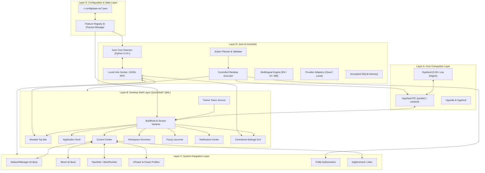
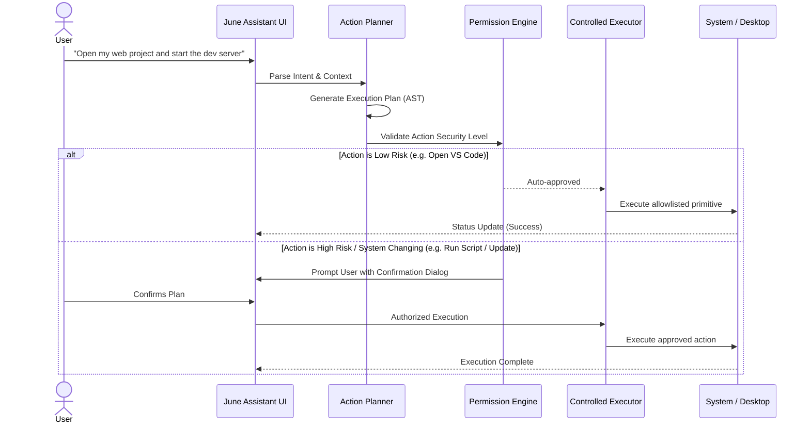
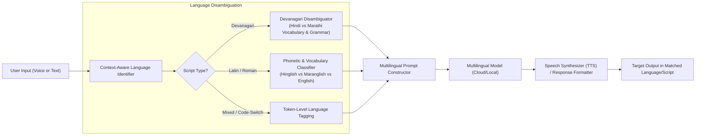

# System Architecture Specification — Custom Arch Linux Desktop + June AI

## 1. Architectural Overview

The system is engineered as an integrated, modular desktop platform for Arch Linux. Unlike conventional loose dotfile collections, it operates through five cleanly separated architectural layers with well-defined interface contracts, ensuring stability, testability, and zero mutual entanglement.



---

## 2. Layer Specifications & Boundaries

### 2.1 Layer A: Core Compositor Layer (Hyprland 0.55+ Lua & Compatibility Bridge)
- **Role:** Window tiling, workspace switching, monitor hotplugging, display scaling, input device ergonomics, and hardware-accelerated Wayland rendering.
- **Language Standard:** Native Lua (`hyprland.lua`), leveraging Hyprland 0.55+'s built-in Lua configuration engine with the global `hl` table.
- **Version Compatibility:** Automated compositor version detection in `install.sh`. When Hyprland >= 0.55 is present, native `hyprland.lua` is executed. For older environments (< 0.55), an automated `hyprland.conf` configuration bridge is deployed to ensure 100% operational compatibility.
- **Modularity:** Main `hyprland.lua` orchestrates self-contained modules under `modules/` (`monitors.lua`, `input.lua`, `keybindings.lua`, `layout.lua`, `windowrules.lua`, `animations.lua`, `autostart.lua`).
- **Compositor IPC:** Communicates outward via Hyprland's UNIX sockets (`$XDG_RUNTIME_DIR/hypr/$HYPRLAND_INSTANCE_SIGNATURE/.socket.sock` for commands and `.socket2.sock` for asynchronous events).

### 2.2 Layer B: Desktop Shell Layer (Quickshell / QML)
- **Role:** Presentation layer for all user-facing desktop panels, bars, widgets, overlays, notifications, and settings interfaces.
- **Engine:** Quickshell (QtQuick/QML Wayland layer shell framework).
- **Core Abstractions:**
  - `ShellRoot`: Global shell lifecycle container and settings distributor.
  - `PanelWindow`: Anchored Wayland surfaces attached to screen edges (`wlr-layer-shell`).
  - `Variants`: Dynamic multi-screen repeater binding per-screen panels (`TopBar`, `Dock`) across active displays (`Quickshell.screens`).
  - `Singleton Overlay Scoping`: Modal dialogs (`Launcher`, `ControlCenter`, `NotificationCenter`, `AssistantWindow`, `Dashboard`, `ClipboardPanel`, `ScreenshotBar`) are scoped to the primary screen, eliminating duplicate memory and process instances when external monitors are connected.
  - `HardwareService`: Centralized QML singleton caching Audio volume, Network SSID, and Battery capacity, eliminating redundant per-widget polling loops.
  - `ThemeService`: Centralized reactive token broker reading from active theme JSON files.
  - `Lazy Subpage Loading`: Heavy settings pages (`FeatureManager`, `PerformancePage`, `BackupPage`) and developer tabs are loaded on demand via QML `Loader` elements.
  - `Input Throttling`: Hardware sliders (Volume, Brightness) utilize 60ms debouncing timers, preventing command storms during mouse drags.

### 2.3 Layer C: System Integration Layer
- **Role:** Mediates access to core Linux system services via native APIs and standard system daemons.
- **Interfaces:**
  - **Networking:** NetworkManager via `org.freedesktop.NetworkManager` D-Bus interface.
  - **Bluetooth:** BlueZ via `org.bluez` D-Bus interface.
  - **Audio:** PipeWire audio graph managed through WirePlumber and `wpctl`.
  - **Display Brightness:** Kernel backlight sysfs interface managed via `brightnessctl` with udev permissions.
  - **Power & Battery:** `org.freedesktop.UPower` and `org.freedesktop.PowerProfilesDaemon`.
  - **Privileged Actions:** Restricted Polkit (`pkexec`) policies for approved system updates; zero plain `sudo` execution.

### 2.4 Layer D: June AI Assistant Layer
- **Role:** Context-aware, multilingual personal AI assistant delivering text, voice, desktop automation, screen intelligence, and local memory.
- **Decoupled Architecture:** Runs as an autonomous background service (`june-daemon`), interacting with the visual shell through an authenticated local UNIX domain socket (`$XDG_RUNTIME_DIR/june/june.sock`) using JSON-RPC 2.0.
- **Subsystem Breakdown:**
  1. **Provider Abstraction:** Unified adapter interface supporting Google Gemini, OpenAI, Anthropic, and local Ollama.
  2. **Multilingual NLP Router:** Handles natural language input and code-switching across English, Hindi, and Marathi in both Devanagari script and Romanized phonetics.
  3. **Action Planner & Validator:** Translates high-level user intents into a structured Abstract Syntax Tree (AST) of discrete operations.
  4. **Controlled Executor:** Strictly allowlisted execution sandbox. Untrusted shell injection is mathematically prevented by executing only predefined operational primitives (e.g., `workspace.switch(id)`, `app.launch(desktop_id)`, `audio.set_volume(delta)`).
  5. **Memory Store:** Scoped SQLite database (`~/.local/share/tejas-os/june/memory.db`) with user-facing editing, redaction, and instant wipe controls.

### 2.5 Layer E: Settings & Configuration Layer
- **Role:** Single source of truth for all user preferences, modular feature states, and themes.
- **Location:** `~/.config/tejas-os/`
  - `features.json`: Granular boolean toggles for every desktop module.
  - `settings.json`: Global user preferences (dock position, bar height, animations).
  - `assistant.json`: June identity, active provider, model name, voice parameters.
  - `languages.json`: Input/output language preferences, auto-detection mode, Romanization support.
  - `theme.json`: Active palette, font families, corner radii, blur filters.
  - `performance.json`: Active power profile, polling throttle intervals, background daemon rules.
- **Integrity Guarantee:** Atomic file writes (write to temporary file, sync to disk, atomic rename) to eliminate corrupted state during unexpected power loss.

---

## 3. Target Hardware Profile & Resource Budget

### Target System: HP EliteBook 840 G5
- **Processor:** Intel Core i5/i7 8th Gen (4 cores / 8 threads)
- **Memory:** 8 GB DDR4 (Single or Dual-channel)
- **Graphics:** Intel UHD Graphics 620 (Mesa / Intel Iris driver)
- **Display:** 14" Full HD (1920x1080 @ 60Hz)
- **Firmware:** UEFI with Secure Boot support
- **Storage & Boot:** Dual-booting alongside Windows 11 on NVMe SSD

### Memory Budget Allocation (8 GB Physical RAM)
| Subsystem | Target Idle Budget | Maximum Allocated Budget | Optimization Strategy |
|---|---|---|---|
| Linux Kernel + Base Daemons | ~450 MB | 600 MB | Minimal background daemons, systemd trim |
| Hyprland Compositor | ~150 MB | 250 MB | Minimal damage tracking, restrained textures |
| Quickshell Visual Shell | ~250 MB | 400 MB | QML lazy instantiation, shared textures |
| Audio/Network/Bluetooth Daemons | ~100 MB | 150 MB | PipeWire + NetworkManager native memory |
| June AI Assistant Daemon | ~150 MB | 300 MB | Python lightweight daemon, Cloud LLM default |
| **Total Idle Desktop Footprint** | **~1.1 - 1.5 GB** | **< 2.0 GB** | **Leaves $\ge 6.0\text{ GB}$ free for apps** |

---

## 4. Security & Safety Model

### 4.1 Dual-Boot Guardrails
Because the host machine dual-boots Windows, the installer and desktop software operate under strict safety constraints:
1. **Zero Partition Alteration:** The installer and dotfiles tools NEVER execute `mkfs`, `fdisk`, `cfdisk`, `parted`, or `wipefs`.
2. **EFI Preservation:** The existing Windows EFI System Partition is mounted read-only during system checks. Bootloader entries for Windows Boot Manager (`bootmgfw.efi`) are untouched.
3. **NTFS Safety:** NTFS partitions are detected and preserved.

### 4.2 June AI Action Sandbox


---

## 5. Wi-Fi Hotspot Architecture

The Wi-Fi Hotspot system provides a dedicated GUI in Settings, Control Center, and June:
1. **Hardware Inspection:** Runs `iw list` to query `Supported interface modes`. Verifies presence of `AP` (Access Point) mode and checks for `AP/STA` concurrency support.
2. **Band & Channel Selection:** Queries 2.4 GHz vs 5 GHz capability. Falls back gracefully if 5 GHz AP is unsupported by local regulatory domains.
3. **Security Standards:** Automatically configures WPA2-Personal (AES) or WPA3-SAE where driver-supported. Insecure WEP is blocked.
4. **Credential Sharing:** Generates an inline SVG/PNG QR code using standard `WIFI:S:<SSID>;T:<WPA|WPA2>;P:<PASSWORD>;;` format.
5. **Client Tracking:** Monitors ARP tables and `iw dev <interface> station dump` to report connected device counts, MAC addresses, and IP leases.

---

## 6. Multilingual Processing Pipeline (English, Hindi, Marathi)



---

## 7. Centralized Design Token System

To eliminate hardcoded styling, themes define atomic tokens organized into a standardized schema:

```json
{
  "name": "Midnight",
  "type": "dark",
  "colors": {
    "background": "#0d1117",
    "surface": "#161b22",
    "surface_variant": "#21262d",
    "border": "#30363d",
    "accent": "#58a6ff",
    "accent_hover": "#79b8ff",
    "text_primary": "#f0f6fc",
    "text_secondary": "#8b949e",
    "text_muted": "#484f58",
    "success": "#3fb950",
    "warning": "#d29922",
    "danger": "#f85149"
  },
  "metrics": {
    "radius_small": 6,
    "radius_medium": 10,
    "radius_large": 16,
    "border_width": 1,
    "bar_height": 38,
    "dock_icon_size": 48
  },
  "typography": {
    "font_family_ui": "Inter",
    "font_family_mono": "JetBrainsMono Nerd Font",
    "font_size_small": 11,
    "font_size_normal": 13,
    "font_size_large": 16,
    "font_size_title": 20
  },
  "effects": {
    "blur_enabled": true,
    "blur_radius": 15,
    "shadow_opacity": 0.25,
    "animation_duration_ms": 200
  }
}
```

Any component consumes tokens through `ThemeService`:
```qml
Rectangle {
    color: ThemeService.colors.surface
    border.color: ThemeService.colors.border
    radius: ThemeService.metrics.radius_medium
}
```
Theme updates emit reactive Qt property change signals, repainting the entire desktop instantaneously without shell restarts.
