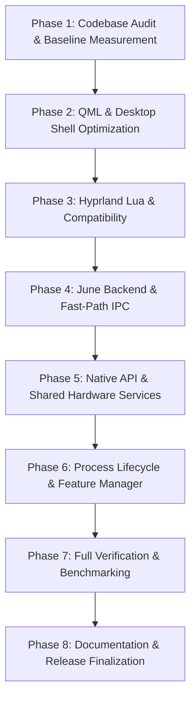

# Master Migration & Refactoring Plan — Tejas OS

This document outlines the step-by-step, evidence-based migration plan for optimizing the **Tejas OS** desktop environment and **June AI** assistant for high responsiveness and an **8 GB physical RAM budget**.

---

## 1. Governance & Refactoring Rules

1. **Zero Feature Regressions**: Preserve all existing features, UI panels, settings, language capabilities (EN, HI, MR in all 7 combinations), and Wi-Fi hotspot GUI.
2. **Never Block Rendering Thread**: Quickshell rendering thread must remain strictly non-blocking. No synchronous HTTP requests, model loading, or shell execution in QML bindings.
3. **Eliminate Redundant Polling**: Replace high-frequency `Timer` subprocess executions with cached event-driven state or reasonable throttled intervals.
4. **Decouple June Service**: Maintain June as an independent background service communicating over Unix domain sockets / JSON-RPC 2.0.
5. **No Speculative Rust**: Only introduce native Rust modules if profiling proves an indispensable performance bottleneck that Python or Linux APIs cannot solve.

---

## 2. Phased Migration Roadmap

---

## 3. Detailed Phase Breakdown

### Phase 1: Codebase Audit & Baseline Measurement (Completed)
- [x] Check Git status; create dedicated branch `refactor/performance-architecture`.
- [x] Create git tag snapshot `baseline-pre-refactor`.
- [x] Full repository file inventory (221 files audited across all subsystems).
- [x] Measure Python startup latency (~498 ms CLI vs 0.055 ms in-process language detection).
- [x] Trace memory footprint (~7.28 MB Python heap).
- [x] Document findings in `PERFORMANCE_AUDIT.md` and `LANGUAGE_MAPPING.md`.

### Phase 2: QML Desktop Shell Optimization
- [ ] **Debounce Hardware Sliders**: Add 50ms debouncing timer to Volume and Brightness sliders in `shell/control-center/ControlCenter.qml` to prevent dozens of concurrent subprocesses during mouse drags.
- [ ] **Lazy Tab Loading in Developer Hub**: In `developer/DeveloperHub.qml`, eliminate `refreshAll()` that spawns 6 Python processes simultaneously. Only refresh the active tab on selection.
- [ ] **Lazy Page Loading in Settings App**: In `shell/settings/SettingsApp.qml`, replace eager loading of all 22 subpages with dynamic `Loader` elements.
- [ ] **Fix Feature Manager Double-Execution**: Remove redundant `running: true` on `Process` in `shell/settings/FeatureManager.qml`.
- [ ] **Modal Overlay Singleton Scoping**: In `shell/shell.qml`, ensure heavy dialog overlays (`Launcher`, `ControlCenter`, `NotificationCenter`, `AssistantWindow`, `Dashboard`, `ClipboardPanel`, `ScreenshotBar`) are not duplicated across multiple monitors.
- [ ] **Suspend Inactive Timers**: In `shell/dashboard/Dashboard.qml`, ensure Pomodoro and vitals polling is active only when the window is visible.

### Phase 3: Hyprland Lua Configuration & Version Detection
- [ ] **Version Detection in `install.sh`**: Inspect installed Hyprland version. Hyprland 0.55+ uses Lua (`hyprland.lua`). Provide verification and fallback compatibility guidance if older Hyprland releases are detected.
- [ ] **Lua Syntax Test Suite Integration**: Wrap `tests/test_lua_syntax.py` and `tests/test_qml_syntax.py` into automated pytest fixtures so they execute during continuous testing.

### Phase 4: June AI Backend & IPC Optimization
- [ ] **Fast-Path Status & Ping**: Refactor `assistant/core/cli.py` to handle `--ping`, `--identity`, and simple queries via lightweight socket IPC without importing heavy AI provider libraries.
- [ ] **Direct Socket Transport for QML**: Implement an asynchronous socket transport or streamlined JSON-RPC helper for `AssistantWindow.qml` so requests communicate directly with `JuneDaemon`, eliminating the 498 ms process launch latency.
- [ ] **Lazy Model Loading Verification**: Ensure voice pipeline and local models release RAM immediately when not in use.

### Phase 5: Native API & Shared Hardware Services
- [ ] **Centralized Hardware Status Bridge (`shell/services/HardwareService.qml`)**:
  - Consolidate Volume, Network, and Battery polling into a single shared singleton service.
  - Eliminate the individual 3s (`AudioWidget`), 10s (`NetworkWidget`), and 15s (`BatteryWidget`) timers that duplicate per monitor.
  - Implement caching and reduce refresh frequency.

### Phase 6: Process Lifecycle & Feature Manager
- [ ] **Verify True Process Termination**: Confirm that disabling a feature in `features.json` terminates its background worker cleanly while preserving protected system daemons (NetworkManager, BlueZ, PipeWire).
- [ ] **Configuration Persistence**: Ensure atomic JSON writes to `~/.config/tejas-os/` remain safe and corruption-free.

### Phase 7: Verification & Benchmarking
- [ ] Run full automated test suite (`python -m pytest tests/`).
- [ ] Measure post-refactor startup times, memory usage, and process count.
- [ ] Document before-and-after metrics in `PERFORMANCE_REPORT.md`.

### Phase 8: Documentation & Release Finalization
- [ ] Update `ARCHITECTURE.md` reflecting the refactored architecture.
- [ ] Update `FEATURE_STATUS.md` with verified status.
- [ ] Create `CHANGELOG.md` recording all architectural optimizations.
- [ ] Update `TESTING.md` with new test procedures.
