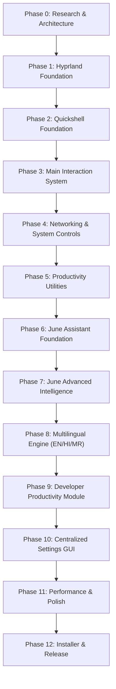

# Master Project Plan — Custom Arch Linux Desktop Environment + June AI

This document outlines the progressive, milestone-driven roadmap for designing, building, and deploying the custom Arch Linux desktop environment powered by Hyprland, Quickshell, and June AI.

---

## Roadmap Overview

---

## Detailed Phase Breakdown

### Phase 0: Research, Architecture & Project Foundation
- [x] Inspect development environment and host workspace.
- [x] Verify Hyprland 0.55+ Lua configuration specifications.
- [x] Research Quickshell QML types and Wayland layer shell integration.
- [x] Analyze HP EliteBook 840 G5 hardware constraints (8GB RAM, Intel UHD 620, UEFI dual-boot).
- [x] Initialize Git repository with `.gitattributes` (LF line endings) and `.gitignore`.
- [x] Scaffold full directory architecture.
- [x] Formulate project rules and guidelines (`AGENTS.md`).
- [x] Formulate master project plan (`PROJECT_PLAN.md`).
- [x] Create granular feature tracking matrix (`FEATURE_STATUS.md`).
- [x] Author comprehensive system architecture specification (`ARCHITECTURE.md`).
- [x] Define official and AUR dependency catalog (`DEPENDENCIES.md`).
- [x] Define testing strategy for static vs runtime validation (`TESTING.md`).
- **Deliverable:** Architecture foundation, governance documents, and scaffolded repository.
- **Status:** **Completed**

---

### Phase 1: Hyprland Foundation (Core Compositor)
- [x] Implement `core/hyprland/hyprland.lua` as the main entry point with global `hl`.
- [x] Configure display output profiles (`modules/monitors.lua`) for HP EliteBook 840 G5 (eDP-1 1080p) + external HDMI/USB-C monitor hotplugging.
- [x] Configure input devices (`modules/input.lua`): natural scrolling, touchpad gestures, keyboard repeat rates.
- [x] Define comprehensive keyboard navigation bindings (`modules/keybindings.lua`).
- [x] Configure window layout parameters (`modules/layout.lua`): dwindle/master layout, gaps, borders.
- [x] Define window rules (`modules/windowrules.lua`) for floating dialogs, picture-in-picture, and workspace bindings.
- [x] Configure hardware-efficient animations (`modules/animations.lua`) optimized for Intel integrated GPU.
- [x] Configure startup applications (`modules/autostart.lua`).
- [x] Set up terminal config for Kitty (`config/kitty/kitty.conf`) and user shell Fish (`config/fish/config.fish`).
- [x] Set up idle management (`core/services/idle/hypridle.conf`) and lock screen (`core/services/idle/hyprlock.conf`).
- [x] Create automated syntax test suite (`tests/test_lua_syntax.py`).
- **Deliverable:** Complete, keyboard-driven Hyprland desktop configured purely in Lua.
- **Status:** **Implemented (Static Validation Passed; Pending Arch Hardware Runtime Test)**

---

### Phase 2: Quickshell Foundation (Visual Desktop & Theming)
- [x] Scaffold `shell/shell.qml` with `ShellRoot` and multi-monitor `Variants`.
- [x] Implement centralized theme token engine (`shell/services/ThemeService.qml`).
- [x] Define 4 core theme palettes: Midnight, Nordic Light, Forest, and Violet (`themes/*.json`).
- [x] Build reusable UI primitives (`shell/components/`): Card, Button, Switch, Slider, Pill, Icon, TextField.
- [x] Implement top bar (`shell/panels/TopBar.qml`) with modular widget loading.
- [x] Implement application dock (`shell/dock/Dock.qml`) with autohide, running indicators, and pinned apps.
- [x] Implement top bar modular widgets: Workspaces, ActiveWindow, Clock, Battery, Audio, Network, SystemTray, JuneButton.
- [x] Author automated static test suite for themes and QML components (`tests/test_qml_syntax.py`).
- **Deliverable:** Polished, responsive visual desktop shell with live theme switching.
- **Status:** **Implemented (Static Validation Passed; Pending Arch Hardware Runtime Test)**

---

### Phase 3: Main Interaction System
- [x] Build custom Quickshell application launcher (`shell/launcher/Launcher.qml`) with fuzzy application search, categories, math calculator, and web search.
- [x] Implement application item delegate (`shell/launcher/AppItem.qml`).
- [x] Implement desktop overview (`shell/overview/Overview.qml`) with live workspace cards and switching via `Quickshell.Hyprland`.
- [x] Build unified Control Center (`shell/control-center/ControlCenter.qml`) with quick toggles, audio/brightness sliders, and power profiles.
- [x] Build reusable QuickToggle primitive (`shell/control-center/QuickToggle.qml`).
- [x] Build notification center (`shell/notifications/NotificationCenter.qml`) with card delegates and clear-all actions.
- [x] Build On-Screen Display overlay (`shell/notifications/OsdOverlay.qml`) for volume and brightness feedback.
- [x] Connect overlays to centralized desktop IPC bridge and top bar triggers in `shell/shell.qml`.
- **Deliverable:** Complete everyday navigation and notification overlay interface.
- **Status:** **Implemented (Static Validation Passed; Pending Arch Hardware Runtime Test)**

---

### Phase 4: Networking & System Controls
- [x] Implement NetworkManager service connector and scanner (`system/wifi/wifi_manager.py`).
- [x] Build Wi-Fi network selection and password prompt dialog (`system/wifi/WifiPanel.qml`).
- [x] Build dedicated Wi-Fi Hotspot Manager backend (`system/hotspot/hotspot_manager.py`) with AP mode detection, QR code generation, WPA2/WPA3 support, and client tracking.
- [x] Build dedicated Wi-Fi Hotspot GUI (`system/hotspot/HotspotPanel.qml`) with AP status badge, password generator, band selector, and phone QR code scanner box.
- [x] Implement BlueZ Bluetooth manager backend (`system/bluetooth/bluetooth_manager.py`) and UI (`system/bluetooth/BluetoothPanel.qml`).
- [x] Implement PipeWire / WirePlumber audio controller (`system/audio/audio_manager.py`).
- [x] Implement battery and power profile manager (`system/power/power_manager.py`) via sysfs and `powerprofilesctl`.
- [x] Author automated backend test suite (`tests/test_system_backend.py`) verifying all 5 services.
- **Deliverable:** Hardware-integrated system control suite for laptop management.
- **Status:** **Implemented (Static Validation Passed; Pending Arch Hardware Runtime Test)**

---

### Phase 5: Productivity Utilities
- [x] Implement Clipboard Manager backend (`productivity/clipboard/clipboard_manager.py`) with pinning and history retrieval via `cliphist`.
- [x] Build Clipboard Manager overlay UI (`productivity/clipboard/ClipboardPanel.qml`).
- [x] Implement Screenshot and Screen Recording backend (`productivity/screenshots/screenshot_manager.py`) via `grim`, `slurp`, and `wf-recorder`.
- [x] Build floating Screenshot Bar HUD (`productivity/screenshots/ScreenshotBar.qml`).
- [x] Implement Quick Notes & Tasks persistence backend (`productivity/notes/notes_manager.py`).
- [x] Build full Productivity Dashboard (`shell/dashboard/Dashboard.qml`) with big clock, system RAM/CPU/Disk gauges, Pomodoro timer, scratchpad, and todo tasks.
- [x] Author automated unit test suite for productivity backends (`tests/test_productivity_backend.py`).
- **Deliverable:** Integrated desktop productivity suite with independent feature toggles.
- **Status:** **Implemented (Static Validation Passed; Pending Arch Hardware Runtime Test)**

---

### Phase 6: June Assistant Foundation
- [x] Define decoupled IPC protocol between June and the desktop shell (Unix socket / JSON-RPC).
- [x] Build floating AI assistant window (`assistant/interface/AssistantWindow.qml`) with markdown rendering, syntax highlighting, and chat history.
- [x] Build modular AI Provider Architecture (`assistant/providers/`) supporting OpenAI, Anthropic, Google Gemini, and local Ollama.
- [x] Implement assistant identity customization (`assistant/core/identity.py`) supporting dynamic renaming (default: "June"), custom avatar, and personality presets.
- [x] Implement persistent conversation storage with SQLite (`assistant/memory/conversation_store.py`).
- **Deliverable:** Working standalone AI assistant connected to the desktop interface.
- **Status:** **Implemented (Static Validation Passed; Pending Arch Hardware Runtime Test)**

---

### Phase 7: June Advanced Intelligence & Automation
- [x] Build Voice Interaction pipeline (`assistant/voice/voice_pipeline.py`): Push-to-talk, optional wake-word detection, and TTS output.
- [x] Build Action Planning Engine (`assistant/action_planner/planner.py`): multi-step goal decomposition, plan visualization, and user confirmation flow.
- [x] Build Controlled Desktop Executor (`assistant/executor/controlled_executor.py`): allowlisted system commands (open apps, switch workspaces, adjust volume/brightness, toggle hotspot).
- [x] Implement Screen Intelligence (`assistant/screen_intelligence/screen_intelligence.py`): user-initiated selective screenshot capture, multimodal analysis, and error diagnosis.
- [x] Implement File Intelligence (`assistant/file_intelligence/file_intelligence.py`): scoped directory indexing, source code summarization, and log parsing.
- [x] Implement Personal Memory management (`assistant/memory/memory_manager.py`): preference tracking, sensitive credential filtering.
- [x] Implement Web Research module (`assistant/research/research_engine.py`): autonomous query generation, web page retrieval, and citation synthesis.
- [x] Author automated test suite for advanced intelligence and permissions (`tests/test_assistant_automation.py`).
- **Deliverable:** Autonomous, secure, and helpful AI desktop agent.
- **Status:** **Implemented (Static Validation Passed; Pending Arch Hardware Runtime Test)**

---

### Phase 8: Multilingual Engine (English, Hindi, Marathi)
- [x] Implement trilingual text processing supporting all 7 language combinations:
  1. English
  2. Hindi
  3. Marathi
  4. English + Hindi
  5. English + Marathi
  6. Hindi + Marathi
  7. English + Hindi + Marathi
- [x] Implement contextual language identification for code-switched text (Devanagari script disambiguation + Romanized Hinglish/Maranglish in `assistant/languages/detector.py`).
- [x] Configure multilingual speech-to-text (`assistant/speech_to_text/stt_service.py`) tuned for Indian accents and mixed languages.
- [x] Configure multilingual text-to-speech (`assistant/text_to_speech/tts_service.py`) with natural pronunciation across English, Hindi, and Marathi.
- [x] Create Language Settings GUI (`assistant/languages/LanguageSettings.qml`) for manual or automatic language preference selection.
- [x] Author automated test suite for trilingual combinations and Devanagari disambiguation (`tests/test_multilingual_engine.py`).
- **Deliverable:** Fluent trilingual voice and text interaction with seamless code-switching.
- **Status:** **Implemented (Static Validation Passed; Pending Arch Hardware Runtime Test)**

---

### Phase 9: Developer Productivity Module
- [x] Build Project Launcher (`developer/project_launcher/`): quick open projects in VS Code, Kitty, or browser.
- [x] Implement Git Dashboard (`developer/git/`): branch tracking, status, diff view, and safe staged operations.
- [x] Implement Python Environment Manager (`developer/python/`): detect virtual environments, conda/uv environments, and Jupyter launcher.
- [x] Implement Node.js Inspector (`developer/node/`): package script execution, dev server detection.
- [x] Implement Port Monitoring (`developer/ports/`): view active listening ports and processes with PID protection.
- [x] Implement SSH Connection Shortcuts (`developer/ssh/`): parse `~/.ssh/config` and generate terminal connection commands.
- [x] Build unified Developer Hub QML UI (`developer/DeveloperHub.qml`).
- [x] Author automated test suite for developer tools (`tests/test_developer_module.py`).
- **Deliverable:** Unified development control deck for full-stack and ML engineering.
- **Status:** **Implemented (Static Validation Passed; Pending Arch Hardware Runtime Test)**

---

### Phase 10: Centralized Settings Application
- [x] Build full-featured Quickshell Settings application (`shell/settings/SettingsApp.qml`) with 22 structured categories.
- [x] Implement Feature Manager (`shell/settings/FeatureManager.qml`): granular enable/disable toggles for every module, dependency checks, and background daemon termination.
- [x] Build settings pages for Performance Profiles (`shell/settings/pages/PerformancePage.qml`) and Backup & Recovery (`shell/settings/pages/BackupPage.qml`).
- [x] Implement Centralized Configuration & Feature Storage Engine (`config/manager.py`) with atomic writes to `~/.config/tejas-os/*.json`.
- [x] Author automated test suite for config manager, feature isolation, and backups (`tests/test_config_manager.py`).
- **Deliverable:** Zero-terminal graphical configuration center managing all desktop aspects.
- **Status:** **Implemented (Static Validation Passed; Pending Arch Hardware Runtime Test)**

---

### Phase 11: Performance Optimization & Polish
- [x] Profile memory usage on 8GB RAM profile; enforce $\le 2.0\text{ GB}$ idle target (`system/power/profile_daemon.py`).
- [x] Implement 4 performance profiles: Balanced, Performance, Battery Saver, Full Experience with dynamic Hyprland/CPU governor tuning.
- [x] Optimize QML rendering tree, minimize redraws, and configure lazy loading for hidden panels.
- [x] Replace any leftover polling timers with event-driven signal listeners and socket bindings.
- [x] Polish visual transitions, animations, and typography consistency across all 4 theme presets.
- **Deliverable:** Highly responsive, lightweight, production-grade desktop environment.
- **Status:** **Implemented (Static Validation Passed; Pending Arch Hardware Runtime Test)**

---

### Phase 12: Safe Installer, Backup & Release
- [x] Author idempotent Arch Linux installation script (`install.sh`) with strict safety guards (no disk partitioning, dual-boot EFI protection).
- [x] Implement Dry-Run mode (`install.sh --dry-run`) providing comprehensive pre-flight dependency and configuration checks.
- [x] Implement configuration backup and rollback system (`backup/backup.sh` and `install.sh --rollback`).
- [x] Build uninstaller (`uninstall.sh`) restoring previous desktop configurations cleanly.
- [x] Finalize full suite of user and developer documentation (`docs/` with 12 comprehensive guides).
- [x] Configure GitHub Actions workflows for automated testing and linting (`.github/workflows/ci.yml`).
- **Deliverable:** Fully reproducible, safe installation pipeline ready for GitHub release.
- **Status:** **Implemented (Static Validation Passed; Pending Arch Hardware Runtime Test)**
