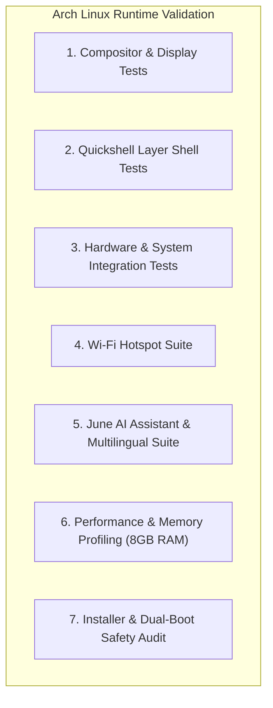

# Testing Strategy & Quality Assurance Matrix — Custom Arch Linux Desktop + June AI

This document establishes the dual-phase quality assurance methodology: **Static Analysis (Windows Development Environment & CI)** vs. **Runtime Verification (Arch Linux Wayland Session on HP EliteBook 840 G5)**.

---

## 1. Testing Philosophy

1. **No Phantom Claims:** A feature is never marked `Completed` simply because its code was written or its UI renders in a mock window.
2. **Clear Environment Boundary:** Static checks prove syntactic validity and schema correctness on Windows. Only native Wayland execution on Arch Linux proves that Hyprland, Quickshell, D-Bus, and PipeWire function as intended.
3. **Safety Verification:** Dual-boot and partition safety checks must be executed with 100% confidence before any installer script is deployed.

---

## 2. Static Analysis Pipeline (Windows Host / CI)

These checks run continuously during development on Windows and in automated GitHub Actions workflows:

### 2.1 Shell Script Validation
- **Tool:** `ShellCheck`
- **Scope:** All `.sh`, `.bash` installer, backup, and helper scripts under `installer/`, `scripts/`, `backup/`.
- **Target:** Zero errors, zero warnings. Enforce POSIX/Bash strict modes (`set -euo pipefail`).

### 2.2 Lua Configuration Validation
- **Tool:** Lua 5.4 syntax linter (`luac -p`) + `luacheck`
- **Scope:** All files under `core/hyprland/`.
- **Global Variables:** Whitelist Hyprland 0.55+ `hl` global stubs:
  ```lua
  -- .luacheckrc
  globals = { "hl" }
  ```

### 2.3 QML & JavaScript Validation
- **Tool:** `qmllint` / QML language server
- **Scope:** All files under `shell/` and `assistant/interface/`.
- **Checkpoints:**
  - Verify all import statements exist (`Quickshell`, `Quickshell.Hyprland`, `Quickshell.Wayland`, `Quickshell.Io`, `QtQuick`, `QtQuick.Layouts`, `QtQuick.Controls`).
  - No unbound or deprecated properties.
  - Zero hardcoded colors (verify theme token binding `ThemeService.colors.*`).

### 2.4 JSON Configuration & Schema Validation
- **Tool:** Python `jsonschema`
- **Scope:** All default configs under `config/` and theme definitions under `themes/`.
- **Checkpoints:** Validate that `features.json`, `settings.json`, `theme.json`, and `assistant.json` adhere to their strict JSON schemas.

### 2.5 Python Daemon Linting & Typing
- **Tool:** `ruff` (linter) + `mypy` (strict type checks) + `pytest` (unit tests)
- **Scope:** All Python code under `assistant/` and `system/`.
- **Checkpoints:**
  - Action planner AST generation tests.
  - Multilingual router token classification tests.
  - Mocked provider adapter responses.
  - SQLite schema migrations.

### 2.6 Line Ending & Encoding Hygiene
- **Check:** Verify that every file in git tracking uses Unix LF (`\n`) line endings and UTF-8 encoding.
- **Verification Command:**
  ```powershell
  Get-ChildItem -Recurse -File | Where-Object { $_.FullName -notmatch '\.git' } | ForEach-Object {
      $bytes = [System.IO.File]::ReadAllBytes($_.FullName)
      if ($bytes -contains 13 -and $_.Extension -match '\.(sh|lua|qml|json|py|md)') {
          Write-Error "CRLF detected in $($_.FullName)"
      }
  }
  ```

### 2.7 Automated Regression & Syntax Test Suite (74 Test Cases)
Run the automated pytest suite across all subsystems:
```powershell
python -m pytest -v
```
**Test suites covered:**
1. `tests/test_assistant_automation.py` (13 tests): Action planning AST decomposition, risk tier enforcement, screen analysis.
2. `tests/test_assistant_foundation.py` (10 tests): Identity configuration, SQLite conversation store, provider registry.
3. `tests/test_config_manager.py` (7 tests): Atomic JSON writes, schema migration, performance profile enforcement.
4. `tests/test_developer_module.py` (17 tests): Project detection, git helper, python/node/ports/ssh inspectors.
5. `tests/test_lua_syntax.py` (1 test): Balanced delimiter and global `hl` syntax verification for all 9 Hyprland Lua files.
6. `tests/test_multilingual_engine.py` (13 tests): 7 language combinations, Devanagari Hindi/Marathi disambiguation, Romanized transliteration.
7. `tests/test_productivity_backend.py` (4 tests): Clipboard history, screenshot orchestrator, markdown notes store.
8. `tests/test_qml_syntax.py` (2 tests): Static syntax verification for all 41 Quickshell QML files and 4 theme JSON presets.
9. `tests/test_system_backend.py` (7 tests): Wi-Fi, Hotspot AP detection, Bluetooth, Audio, Power profile daemons.

---

## 3. Runtime Verification Matrix (Arch Linux Wayland Host)

The following checklist must be systematically verified on actual Arch Linux hardware (HP EliteBook 840 G5):



### 3.1 Compositor & Display Tests
- [ ] Hyprland launches via `hyprland` without fallback errors.
- [ ] Internal display `eDP-1` correctly set to 1920x1080 @ 60Hz.
- [ ] External monitor hotplugging (HDMI / USB-C DP) detected without compositor crash.
- [ ] Workspaces 1 through 5 switch fluidly via `Super+1`..`Super+5`.
- [ ] Dwindle tiling, splitting, floating toggle (`Super+V`), and full-screen toggle (`Super+F`) work.
- [ ] Touchpad natural scrolling, tap-to-click, and 3-finger swipe gestures respond accurately.

### 3.2 Quickshell Layer Shell Tests
- [ ] Top bar anchors cleanly to top of screen via `PanelWindow` without overlapping client windows.
- [ ] Clock, date, battery level, network glyph, and volume slider update dynamically.
- [ ] Dock renders pinned icons, displays running application dots, and autohides smoothly.
- [ ] Application launcher opens on `Super+Space`, filters applications with fuzzy search, and launches selection.
- [ ] Control Center toggles activate/deactivate hardware states cleanly.
- [ ] Live theme switching switches between Midnight, Nordic, Forest, and Violet instantaneously.

### 3.3 Hardware & System Integration Tests
- [ ] **Audio:** Volume adjustment changes PipeWire master output; muting functions; headphone jack switch detected.
- [ ] **Brightness:** `brightnessctl` steps from 5% to 100% smoothly without tearing.
- [ ] **Battery:** UPower emits discharging/charging status; low battery notification fires at 15%.
- [ ] **Bluetooth:** Scanning lists nearby devices; pairing headset connects audio sink.
- [ ] **Lid Behavior:** Closing laptop lid triggers suspend; opening lid resumes session cleanly.

### 3.4 Wi-Fi Hotspot Test Suite
- [ ] Driver inspection confirms `AP` mode support on Intel wireless card.
- [ ] Starting hotspot generates virtual AP interface with specified SSID and WPA2/WPA3 passphrase.
- [ ] QR code renders accurately and connects smartphone when scanned.
- [ ] Client device obtains DHCP lease and reaches internet via upstream connection.
- [ ] Connected device list displays connected smartphone MAC address.
- [ ] Stopping hotspot dismantles AP cleanly without breaking normal Wi-Fi station connectivity.

### 3.5 June AI Assistant & Multilingual Test Suite
- [ ] Daemon launches as user systemd service and creates `$XDG_RUNTIME_DIR/june/june.sock`.
- [ ] Assistant UI window toggles via shortcut (`Super+J`).
- [ ] Cloud provider connection test succeeds (Gemini / OpenAI / Anthropic).
- [ ] Action Planner decomposes complex command ("Open dev project") into allowlisted steps.
- [ ] User confirmation modal appears before executing privileged actions.
- [ ] Emergency Stop button instantaneously cancels active execution plan.
- [ ] **Multilingual Test Cases:**
  - English: *"Open terminal and check git status."*
  - Hindi (Devanagari): *"मेरा प्रोजेक्ट खोलो और गिट स्टेटस देखो।"*
  - Marathi (Devanagari): *"माझा प्रोजेक्ट उघड आणि गिट स्टेटस बघ."*
  - English-Hindi code-switch: *"June, mera project open karo aur server start karo."*
  - English-Marathi code-switch: *"June, majha VS Code project ughad."*
  - Hindi-Marathi code-switch: *"माझा project open कर aur browser chalav."*
  - Trilingual: *"June, majha project folder ughad aur dev server start karo."*
  - Romanized Hindi/Marathi correctly routed to language engine without hallucinated translations.

### 3.6 Performance & Memory Profiling (8 GB RAM Budget)
- [ ] Idle memory measured using `ps_mem` and `htop`:
  - Target: Base environment + Hyprland + Quickshell + June idle $\le 1.5 - 2.0\text{ GB}$.
- [ ] CPU utilization stays $\le 2\%$ when idle (no runaway polling loops).
- [ ] Quickshell CPU load remains $< 1\%$ when idle.
- [ ] Profile switching (Balanced vs Performance vs Battery Saver) modifies refresh rates and background timers.

### 3.7 Dual-Boot Safety Audit
- [ ] Run `install.sh --dry-run` and inspect all output actions.
- [ ] Confirm no calls to `mkfs`, `fdisk`, `parted`, `sgdisk`, or `wipefs` exist anywhere in codebase.
- [ ] Verify EFI partition is mounted read-only during checks.
- [ ] Verify existing Windows bootloader file (`/boot/efi/EFI/Microsoft/Boot/bootmgfw.efi`) remains intact and unmodified.
