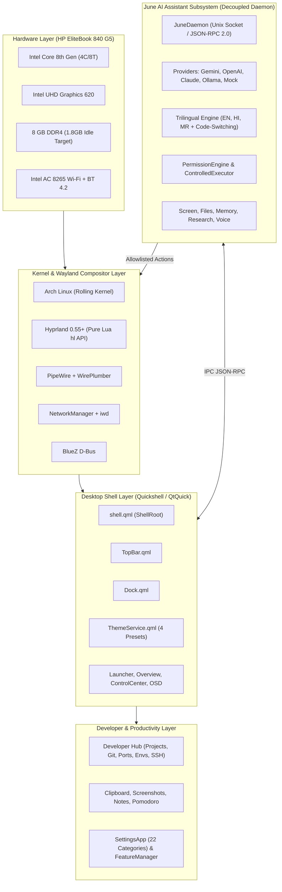

# Tejas OS Architecture & System Design

## 1. Overview
**Tejas OS** is a unified, highly optimized custom desktop environment paired with **June AI**, an autonomous trilingual desktop companion. It is specifically engineered for an **HP EliteBook 840 G5** (8 GB RAM, Intel Core i5/i7 8th Gen, Intel UHD Graphics 620) running **Arch Linux** in a dual-boot UEFI setup alongside Windows 11.

---

## 2. Core Architectural Principles

### 2.1 Hyprland 0.55+ Pure Lua Configuration
- Hyprland 0.55+ completely supersedes legacy `hyprlang` configurations in favor of native Lua scripting.
- All compositor configurations are declared using the official global `hl` table API: `hl.config()`, `hl.bind()`, `hl.monitor()`, `hl.env()`, `hl.on()`, etc.
- Modularized into `core/hyprland/modules/`:
  - `monitors.lua`: Dual-head auto-detection, default 1080p 60Hz.
  - `input.lua`: Touchpad gestures, natural scrolling, tap-to-click.
  - `keybindings.lua`: Ergonomic Super-key bindings.
  - `animations.lua`: Hardware-tuned bezier curves optimized for Intel UHD 620.
  - `layout.lua`: Dwindle tiling layout with smart gaps.
  - `windowrules.lua`: Floating rules, opacity, and layer rules.
  - `autostart.lua`: Daemons, polkit, and Quickshell launch.

### 2.2 Quickshell & QML Presentation Layer
- Desktop widgets and overlays are constructed using **Quickshell** (`ShellRoot`, `PanelWindow`, `WlrLayershell`).
- Clean separation of concerns:
  - **View Layer**: Pure declarative QML.
  - **State & Theme**: Centralized `ThemeService.qml` with dynamic preset switching.
  - **System Integration**: Background Python services communicating via JSON over stdout or D-Bus.

### 2.3 Decoupled June AI Assistant
- June AI operates as an independent service (`assistant/core/daemon.py`).
- Desktop shell remains 100% operational when June is offline or stopped.
- Communication uses JSON-RPC 2.0 over standard Unix domain sockets (`/tmp/june-ai.sock`).
- Dynamic renaming support (default: "June") via identity engine.

### 2.4 Modular Feature Isolation (Rule 1.4)
- Every desktop module has an independent toggle in `~/.config/tejas-os/features.json`.
- Disabling a feature actively terminates background processes/daemons to free memory.
- Core daemons (`NetworkManager`, `BlueZ`) are protected and never killed.

### 2.5 Strict Dual-Boot & System Safety (Rule 1.5)
- Under NO circumstance does any component format disks, alter Windows NTFS partitions, or modify the Windows EFI bootloader (`bootmgfw.efi`).
- User-space dotfiles configurator and package manager only.
