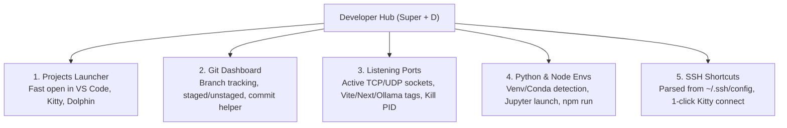

# Developer Hub & Productivity Manual

## 1. Overview
The **Developer Hub** (`developer/DeveloperHub.qml`) is a unified control deck for full-stack and systems engineering. Summon it anytime with **Super + D**.

---

## 2. Tab Breakdown

### Tab 1: Projects Launcher
- Scans `~/Projects`, `~/Work`, `~/Developer`, and current directories for code projects.
- Detects project ecosystems: **Python**, **Node / TypeScript**, **Rust**, **Go**, **C / C++**, **Arch Dotfiles**.
- Shows active git branch.
- One-click launch actions:
  - **Code:** Opens project in VS Code or Codium.
  - **Kitty:** Spawns a dedicated Kitty terminal in the project directory.
  - **Files:** Opens directory in Dolphin file manager.

### Tab 2: Git Dashboard
- Real-time git status for active workspace.
- Branch name, short commit hash, ahead/behind counters.
- Visual lists of staged, unstaged, and untracked files.
- **Stage All** action and commit message input box with atomic commit.

### Tab 3: Listening Ports Inspector
- Active TCP and UDP sockets table.
- Identifies well-known developer ports:
  - `3000`: React / Next.js
  - `5173`: Vite / Svelte / Vue
  - `8000`: FastAPI / Django
  - `8888`: Jupyter Notebook / Lab
  - `5432`: PostgreSQL
  - `11434`: Ollama LLM
  - `42421`: June AI Daemon
- **Safe Process Termination:** Refuses to kill PID $\le 100$, systemd, or protected system daemons.

### Tab 4: Python & Node Environments
- Discovers `.venv`, `venv`, Conda, uv, and system Python interpreters.
- Jupyter Notebook/Lab status and quick launcher.
- Node.js runtime versions (`node`, `npm`, `pnpm`, `yarn`, `bun`).
- Lists runnable `package.json` scripts (`dev`, `build`, `test`, `lint`) with one-click execution.

### Tab 5: SSH Shortcuts
- Safely parses `~/.ssh/config` for configured host bookmarks.
- Displays alias, user, hostname, and port.
- **Connect Button:** Spawns a Kitty terminal with `kitty --title "SSH: <alias>" ssh <alias>`.
