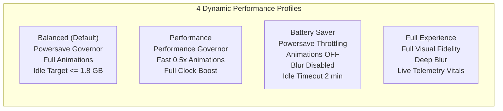

# Performance & Memory Management Guide

## 1. 8 GB RAM Budget Architecture
The **HP EliteBook 840 G5** is equipped with 8 GB of RAM and an integrated **Intel UHD Graphics 620** GPU. Under Wayland and Hyprland, memory and rendering performance are governed by strict resource ceilings:

- **Idle Memory Budget:** $\le 1.5 - 2.0\text{ GB}$ (leaving $\ge 6.0\text{ GB}$ free for development workloads, VS Code, and browser tabs).
- **GPU Optimization:**
  - Continuous border angle rotations and heavy full-screen blur passes are disabled on the Intel UHD 620 to eliminate frame drops and preserve 60 FPS fluidity.
  - Hyprland animations utilize restrained duration curves (150ms–200ms) to conserve battery.

---

## 2. The 4 Performance Profiles

Managed by `system/power/profile_daemon.py` and `config/manager.py`:



### Switching Profiles
- **Via GUI:** Open Settings (`Super + I`) -> Navigate to **Performance Profiles**.
- **Via CLI:**
  ```bash
  python3 -m config.manager --profile battery_saver
  python3 -m config.manager --profile performance
  python3 -m config.manager --profile balanced
  ```

---

## 3. Event-Driven Architecture vs. Polling
- **Never use polling loops:** High-frequency timers (e.g. `setInterval(..., 100)`) are strictly banned.
- System metrics update via D-Bus signal subscriptions, UDev kernel events, and socket notifications.
- Hidden QML overlays employ lazy-loading and disable background drawing when closed.
